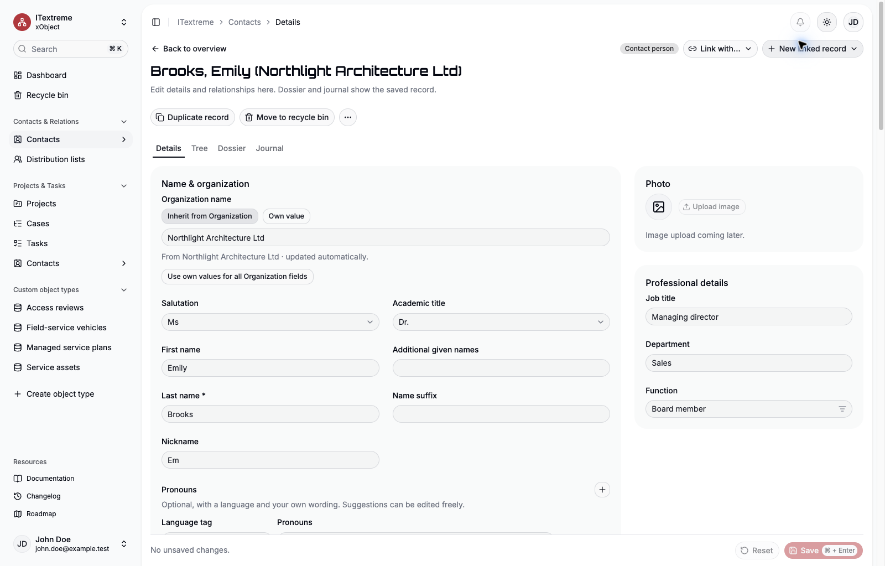
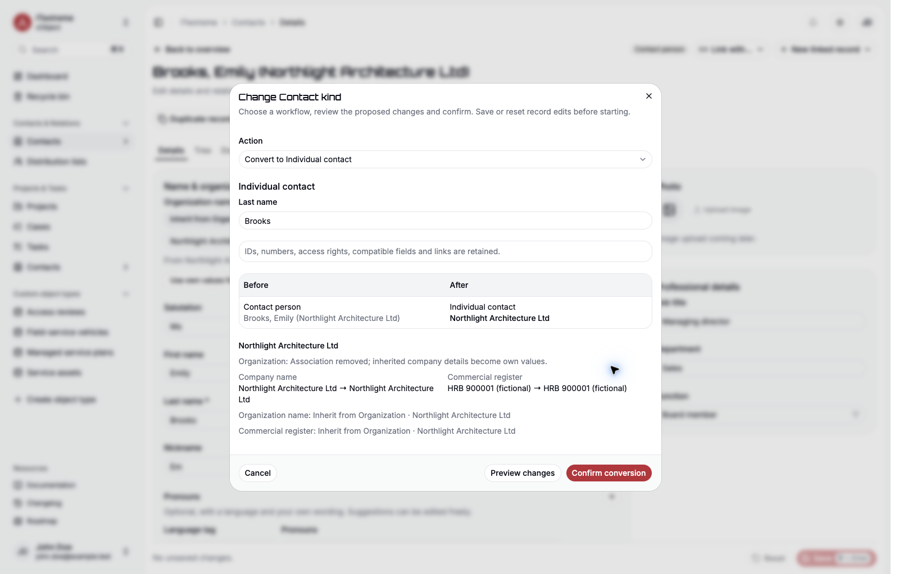

# Contacts and distribution lists

Use Contacts & Relations to maintain organizations and people, connect separate records for the same person, and build explicit distribution lists. You need content access to the objects; creating records additionally requires Create permission. Enable the module first if it is not available in your workspace.

## Choose the contact kind before creation

Open **Contacts → Create record** and choose one kind:

| Kind | Use it for | Readable name |
| --- | --- | --- |
| Organization | A company, association or other organization | Company name |
| Contact person | A person in the context of one organization | Derived personal/organization name |
| Individual contact | A person or sole business maintained independently | Company name when filled, otherwise Last name, First name |

Contact kind is separate from configurable **Type**. An organization might have Type Supplier; that does not make Supplier another contact kind. Normal editing cannot change the kind. Community 1.2.0 adds guided conversions and per-field Organization inheritance, described below.

The form shows the applicable fixed core. Keyword is derived, so there is no separate editable Keyword input. Additional fields and custom relationships can be arranged in the [Form designer](forms.md#supplied-contact-forms).

## Create an organization and its contact person

1. Create an Organization called **Example Studio** and save it.
2. Create a Contact person called **Alex Morgan**.
3. In its Organization relationship, choose the saved Example Studio record. Save the Contact person.
4. Open the Organization's linked records to inspect its Contact persons, subject to your rights.

A Contact person can have **at most one Organization**. Changing this relationship does not delete either record. Job title, Department and Function belong to the Contact person itself and remain unchanged when the Organization changes. Check them after a move. Individual contacts also expose these professional fields; Organizations show their applicable company fields instead.

## Maintain names and personal details

Salutation is correspondence metadata. Academic title, First name, Further names, Last name and Name suffix describe the person's name. Salutation does not contribute to the derived formatted name. Choose configured suggestions where offered; a Designer can configure supported input aids without changing the protected Contact structure.

Birthday, Wedding anniversary and Date of death accept a known month/day without inventing a year. Clear the year explicitly when it is unknown. A Contact's time zone and communication languages describe that Contact; they do not change your own interface language or display zone. Photo/Logo is a preparation placeholder; uploading is not available in V1.

## Correspondence

**Form of address** chooses Formal or Informal wording. **Letter salutation** proposes a greeting from the person's name, Salutation and form of address. Enter individual wording when needed; **Use suggested salutation** removes that exception. A missing name or permission can leave the suggestion empty. These fields prepare correspondence; xObject does not send a letter or email.

**Pronouns** stores optional, freely editable wording with a language tag for each entry. Suggestions are editable input aids, not a rule inferred from Gender or Salutation. These correspondence fields and Pronouns are available from Community 1.1.0.

## Telephone, email, messenger and postal details

Add separate entries for different telephone numbers, email addresses, websites, messenger URIs and postal addresses. Usage offers **Work**, **Home** and **Other**; email, website and postal entries can also have no usage label. Telephone and messenger entries offer a separate Type. The ordinary form selects at most one value in each dimension, for example Work + Mobile. Retained additional labels remain visible and removable. These labels describe an entry; they do not send messages or alter a URI.

Use the move controls to put the preferred entry first. Order determines preference, starting at 1; deleting or moving an entry updates that order. Collections support up to 100 entries each. The website arrow opens a valid HTTP(S) address in a new tab while preserving your draft.

Messenger addresses use a URI such as `xmpp:alex@example.test`. Here `xmpp:` identifies the messaging protocol; a Type label is descriptive and does not add the prefix automatically. Enter the URI required by the service, not a password or credential.

For postal addresses, enter the available components, including Region before Country. Search the Country picker by its localized name. The preview uses entered components; you do not need to type a second formatted address. It is a readable preview, not a guarantee of a postal carrier's country-specific layout.

Save the whole Contact after editing. Entry additions, reordering and corrections remain a local draft until then. Validation identifies the affected input; the Journal records changes per field, including structured-entry context.

## Link identities without merging records

Use **Identities** when an Individual contact and/or Contact person records represent the same human in different contexts. For example, link Alex's independent contact to Alex at Example Studio.

Choose **Link with…**, select Contacts and the Identities relationship, then choose the permitted existing record. Organizations are not eligible. Identities is symmetric and direct: linking Alex A to Alex B and Alex B to Alex C does not automatically create every other link. Names, professional details and rights remain separate. This is not account linking or duplicate merging.

## Family and Organization affiliations

Use **Link with… → Contacts** for Parents/Children, Partners, Siblings and Organization affiliations. Select the relationship that describes the actual context. These links stay inside the workspace, remain subject to both records' rights and do not copy contact details or grant access. Organizations do not participate in the personal family links. Affiliation is separate from a Contact person's single main Organization; an Individual may have several contextual Organization links.

Type and Category choices are workspace configuration. A value such as Association or Supplier describes your classification, not a fourth Contact kind. From 1.2.0, module installation no longer proposes Association as a Type; existing configured choices and values are retained.

## Build a distribution list

1. Open **Distribution lists**, create a record and give it a Keyword such as **Workshop attendees**.
2. Add an optional short Description and save.
3. Use the Members relationship to link permitted existing Contacts. You can also use **Link with…** and the appropriate relationship label.
4. Inspect Members or the Dossier to verify the actual linked records.

Membership is explicit; no organization, category or group automatically adds all its contacts. Removing a membership keeps the Contact. A distribution list is a business record, not a login group and not a permission grant. V1 stores the list; it does not send mail or invitations.

Use Notes for working observations and the Journal for recorded changes. [Record actions and recovery](user-guide.md) apply to Contacts and Distribution lists as to other records. Standards-oriented storage is a foundation for later exchange; vCard import/export and CardDAV synchronization are not available in V1.

## Organization inheritance

*Fictional ITextreme Contact: Organization name follows the main Organization. Choose Own value to prepare an exception, then save the record.*

[Open the full-size Contact image](../apps/site/src/assets/screenshots/contact-en-light.png).

On a Contact person, Organization name and Commercial register initially show the readable main Organization value. Choose **Own value** beside either field to edit a local exception. An own empty value stays empty. **Inherit from Organization** asks before discarding an exception. **Use own values for all Organization fields** prepares both fields together; the ordinary Save applies the draft. Reset discards the unsaved edits.

Changing Organization keeps own exceptions and refreshes inherited fields. Removing the Organization leaves inherited fields empty. Personal communication/address entries never acquire an Organization fallback. The Contact Keyword still names the actual linked Organization, even when the displayed Organization-name field has an own exception.

You need permission to read the source Organization and its field to see an inherited value. Editing an own exception additionally requires the Contact person's field to be editable. No visible source value does not prove the Organization's field is empty. Source changes appear as current inherited values; they do not create pretend edit events on every Contact person.

In cross-kind settings, column selection and field-rights controls, Commercial register is qualified by its Contact kinds. Organization/Individual values and Contact-person inheritance remain separate field identities. The Contact-person fields permit editable own exceptions within current rights; generated Keywords and record numbers remain read-only.

## Change a Contact kind

Save or reset edits first. Open **Record actions** (the three-dot menu beside Duplicate/Recycle), choose **Change Contact kind**, then select a workflow. Complete missing required values. For a new Organization, enter its name, classification and applicable required fields; for an existing Organization, search and choose it. **Preview changes** lists the affected Contacts, their current/resulting Keywords, kinds, Organization assignment and field/exception mappings. Confirm only after reviewing them.

| Start from | Workflow | Result |
| --- | --- | --- |
| Individual contact | Create a new Organization | The existing person becomes its Contact person; the new Organization receives its own identity and number |
| Individual contact | Join an existing Organization | The person becomes its Contact person; the Organization's contents remain unchanged |
| Contact person | Continue as an Individual | Readable effective company/register values become the Individual's own fields; the main membership is removed |
| Organization | Continue all Contact persons as Individuals | All current Contact persons change together; the Organization itself remains |

Existing Contact IDs, numbers, access rights and compatible contents/links remain. A new Organization gets its own ID/number. Company/register differences are preserved as exceptions instead of overwriting the target Organization. Incompatible custom fields or links must be resolved first; a conflict, missing right or stale preview leaves the entire operation unchanged. Full access to every affected Contact and the relevant field rights are required; creating an Organization also needs Create. API/MCP clients use `get_contact_conversion_preview` and `convert_contact`; normal `update_record` cannot change Contact kind. [ADR 0038](adr/0038-contact-inheritance-and-conversions.md) records the exact mapping and permission rules.

*The fictional ITextreme Contact person becomes an Individual. Its inherited company name is retained, so that company name becomes its Keyword. The preview has not changed any record.*

[Open the full-size conversion image](../apps/site/src/assets/screenshots/conversion-en-light.png).
