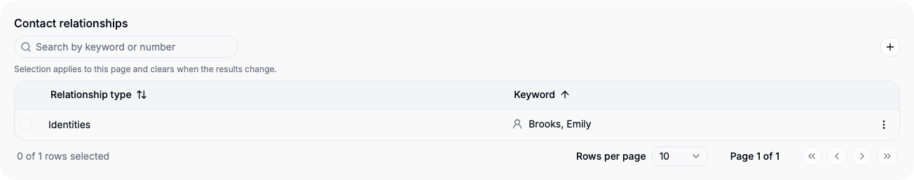

# Arrange record forms

Use **Settings → Workspace → Form designer** as an Administrator or workspace Designer. The designer arranges existing fields and relationships; create their definitions first in Object types or Relationship types. Ordinary Users can inspect the designer read-only.

## Build a readable layout

Select an existing object type. For the custom Devices example from [object design](model-design.md):

1. Keep the initial **General** group or rename it using the translation editor.
2. Assign Keyword and Serial number to General with each element's **Group** selector.
3. Add a group for Purchase details; assign Purchase price and Purchased on to it.
4. Set group/field widths, and move groups or elements using their up/down controls.
5. Place Notes in a final full-width group. Save, then open a Device record to inspect the actual layout.

Half-width groups can sit side by side on a wide screen; narrow screens stack them. A field can be half or full width where supported. Lists/tables and the complete Primary chain use full width. Group names and order have no domain meaning: there is no mandatory Business details or Relationships group.

Saving changes the common form for the object, including its appearances in different module sections. Personal navigation arrangements do not create personal forms. Reset discards the pending layout changes; switching objects with a dirty draft asks for a decision.

## Place relationships and access controls

Custom one-target relationships render as fields and can sit beside suitable scalar fields, such as a Device's service contract in General. Multi-target relationships render as tables; give them enough room in an appropriate group. The cardinality is defined by the relationship, not by choosing a narrower form width.

Relationship controls offer visibility and, for tables, initial expansion settings. A hidden optional relationship can be revealed temporarily from the record. Hiding a control grants no confidentiality: current backend rights still govern the relationship and its values. Required Primary/relationship elements remain visible. The Primary chain is a single form element; you cannot redefine Contact → Project → Case in the designer.

On sensitive objects, the protected **Access principals** field can be positioned, ordered and given a supported width using its existing identity. This changes its placement, not its ownership or activity-assignment behavior. [Access administration](access-administration.md) explains its rights details.

## Combine relationship lists

Move the desired to-many relationship sides into a full-width group, name it and enable **Show relationships in one list**. The first column names each relationship from the current record's side. The remaining columns identify the linked record. Parents and Children can appear together alongside Partners, Siblings, Identities, affiliations or an Organization's Contact persons. Single-target relationships and the Primary chain stay separate.

New Contacts-module templates suggest **Contact relationships / Kontaktbeziehungen** for these supplied sides. Existing authored layouts are retained; apply the grouping explicitly in the designer when needed. The template is a starting arrangement, not a special table implementation or a reserved group name.

The **Object type column** preference is available on combined groups and individual to-many entries: **Automatic**, **Show** or **Hide**. Automatic uses allowed endpoint definitions, including for an empty list, and omits the column for a single target object. Enable **Contact-person professional columns** separately when Job title, Department and Function are useful for that list. Their values remain permission-filtered; family lists can keep the lean presentation. Both preferences also apply to the selection dialog.

Use **Add General relationship to the form** to place that existing relationship explicitly, individually or in a combined group. It otherwise remains available through the header and Dossier. The Primary chain is excluded from combined lists. Expansion settings apply to individual collapsible lists; combined groups display a table directly.

The table shares search, sorting and pagination with other record tables. Its plus menu first asks which relationship to add, then opens the normal record picker. It remains available in a saved Contact's overview, including when empty, subject to edit rights. Applying a selection prepares an unsaved record draft; review it and Save or Reset using the usual footer. Removing a row removes that edge only. The same Contact may appear in several rows for different relationships.

Combining lists changes presentation metadata. It retains cardinalities, requiredness, permissions, optimistic versions, record identities and atomic journals. The common form configuration is available through UI, API and MCP.

## Unassigned and removed groups

Newly added elements remain Unassigned until you place them. They remain available; adding or deleting a group never deletes field definitions or data. Removing a group moves its elements to Unassigned. Required inputs must remain reachable. Do not use form placement as a permission boundary or as a substitute for [definition lifecycle](model-design.md#place-fields-link-objects-and-manage-lifecycle).

## Supplied Contact forms

Organizations, Contact persons and Individual contacts have fixed kind-specific core forms. Their name, professional, channel/address, language/time and applicable personal/company sections are provided by the module. The designer arranges additional fields and relationship lists, including configurable supplied family, identity, affiliation and Contact-person lists. The single main-Organization selector stays in the protected core.

The core's intended input aids, labels and supported field rules remain configurable in Object types, subject to protection and existing-data validation. You cannot move/remove protected core components or turn a Contact person into an Organization by rearranging the form.

Projects, Cases and Tasks instead have editable supplied starter layouts. They keep protected field/domain semantics even when their groups move. One shared Contacts object has one common extension layout across modules; there is no module-specific form selector.

Conditional visibility by Type/Status is [planned](PRD.md#34-planned-conditional-field-visibility). Current semantic applicability is different: it determines whether a value is valid, not merely whether its control is visible.

## Contact reading and classification filters

Saved Contacts display field values rather than disabled inputs. Type and Status use their configured labels; hierarchical Categories show paths without repeating selected ancestors. Inherited Organization fields show their mode and readable source. An explicit empty own value remains visible as an exception. Edit contact opens the same core section order for changes; custom extension fields retain their configured grouping.

A tree Category filter opens a searchable, keyboard-operable dialog. Choose criteria and Apply filters; remove individual criteria using the path-labelled buttons. Criteria within one classification are OR-combined; Type, Status and Category are AND-combined. A parent criterion matches records in its descendants because stored selections include ancestors. Selecting a child filter does not additionally select its parent. Inactive and empty values remain filterable. These query rules differ intentionally from record entry, which selects ancestors automatically.
