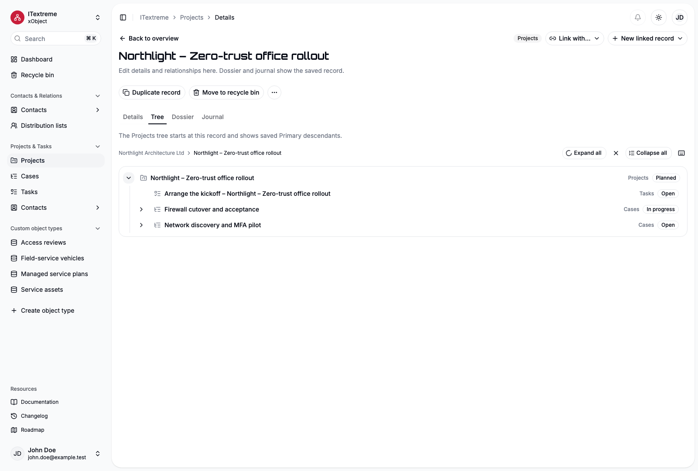

# Projects, Cases and Tasks

Use Projects & Tasks to group work, track individual actions and navigate their Primary context. The module also reuses Contacts. You need access to each object and Create permission for new records; a link to a Project does not grant access to its Tasks.

## Choose the right record

| Object | Example | Purpose |
| --- | --- | --- |
| Project | Website refresh | A larger piece of work with optional Contact context |
| Case | Launch preparation | A distinct matter within or outside a Project, such as an inquiry or work package |
| Task | Review homepage copy | An action to perform, with optional priority, dates and progress |

A Case is not required for every Task. Types, statuses and categories are configurable; the supplied objects do not impose a ticketing or approval workflow.

## Connect the work

1. Create a Project called **Website refresh**. Select **Example Studio** in Primary association when it is work for that Contact; leave Contact empty for internal work when the definition permits it.
2. Create a Case called **Launch preparation**, select the Contact and Project, and save.
3. Create a Task called **Review homepage copy** and select the Case. Its Project and Contact context are derived.
4. Inspect the Project's tree or Dossier to verify the connections.

Selecting a Contact filters Project candidates; selecting a Project filters Cases. Changing or clearing an earlier level clears later draft selections. It does not delete those records. Only the deepest direct Primary parent is saved. Object configuration may require particular levels. [Connecting records](user-guide.md#connect-records) explains other relationship actions.

*Fictional ITextreme example: the tree follows the Project's Primary descendants. General and custom relationships remain available through the Dossier.*

[Open the full-size tree image](../apps/site/src/assets/screenshots/project-en-light.png).

## Assign and coordinate

Projects, Cases and Tasks are always user-sensitive. **Access principals** is their ownership and activity-participation list; on a Task it is the assignment. New sensitive records initially include their creator.

To hand a Task to an eligible user or team, edit Access principals and its ownership level with Full access, review your own remaining access, then save. A group entry follows current group membership. Expanding a group deliberately replaces it with individual entries. A participating team does not mean every member must complete a separate copy.

**Responsible** is the coordinating reference. Setting it does not assign the activity or grant rights. Foreign access lets another person inspect/edit work without adding them as a participant. V1 does not send assignment notifications. See [ownership and foreign access](access-administration.md#ownership-and-foreign-access).

## Set dates and progress

Projects and Cases have optional Start and Target date. They are calendar dates; the target may equal the start. Description explains the intended work, while Notes can hold a timestamped working history.

Tasks have optional Start and Due with three supported temporal forms:

| Form | Example | Meaning |
| --- | --- | --- |
| Date | 2026-11-12 | A day without a time zone |
| Instant | 2026-11-12T09:00:00Z | A fixed moment, displayed in the effective viewer zone |
| Zoned time | 10:00 in Europe/Berlin | A local wall time with an explicit named zone |

Choose the matching mode in the temporal control. Start and Due are independently optional. If both are filled, they must use the same form and Due must be strictly after Start. Nonexistent daylight-saving times are rejected; an ambiguous time requires an explicit earlier/later occurrence. Changing your display zone does not move a Task's domain zone or change a date-only value.

Priority belongs to Schedule & progress, above Progress. Progress is an optional percentage from 0 to 100. Its relationship to completion is checked when saving.

## Complete and reopen a Task

A Designer or Administrator configures which Status has the meaning **Done**; the translated label alone does not determine completion.

1. Select the configured completion Status.
2. Review the proposed 100% and completion timestamp. Adjust the timestamp if needed.
3. Save the record. Status, Progress and Completed at commit together.

A Done Task requires 100% and a completion instant. An empty or other Status cannot retain those completion values. Reopening proposes the corresponding reset; review it before saving. Unrelated edits preserve an existing completion time. External API/MCP clients submit a complete consistent change rather than relying on the browser proposal.

The supplied forms are editable starter layouts, unlike the fixed Contact core. Use the [Form designer](forms.md) for placement and [model configuration](model-design.md#configure-typestatus-and-category) for input aids. Calendar views, recurrence, reminders, invitations and subprojects/subcases/subtasks remain later scope.
