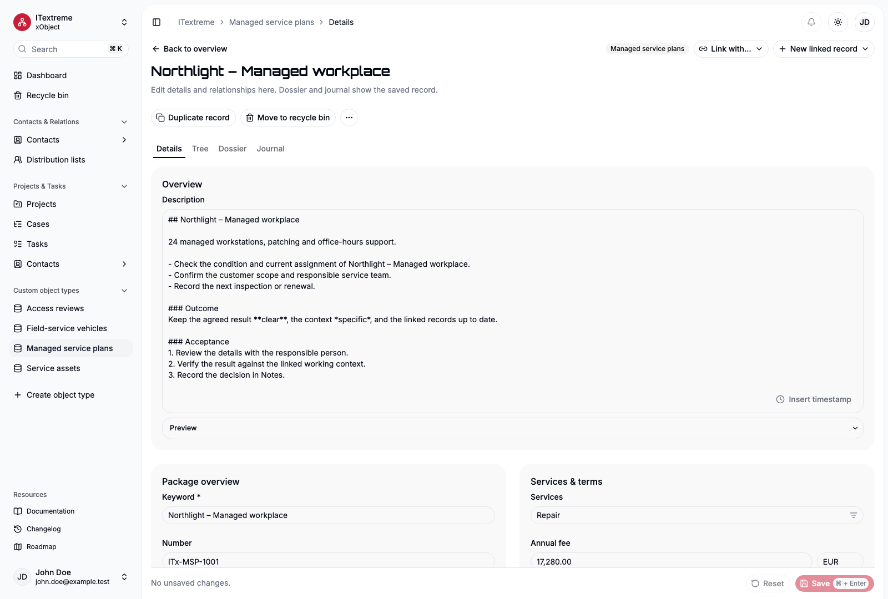
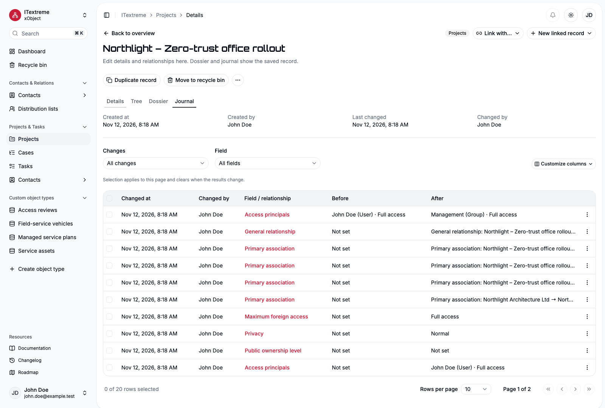

# Using xObject

xObject connects Contacts, Projects, Cases, Tasks and your own object types in workspaces. Version 1 is entirely Community. This guide describes Community 1.2.0. Use a [released documentation snapshot](versions.md) when your installation runs an earlier version.

For an empty installation, start with [First steps](first-steps.md), including workspace creation and module activation.

## Sign in and choose a workspace

Your installation Administrator creates accounts. A new ordinary account must change its initial password before using the app. The first Administrator is created by the [installation operator](self-hosting.md#initialize-and-sign-in).

Choose a workspace in the sidebar. Search combines permitted navigation and record results. Use **Cmd/Ctrl + K** to open it; keyboard help is available in the user menus. In supported forms, **Cmd/Ctrl + Enter** submits Save. Native Tab, arrow-key and menu navigation remain available.

Lists show the object's icon and standard fields. Search, filters, sorting, column visibility, row counts and paging are shared across views. Selection applies to the current page; it does not authorize a bulk operation. Open a row to inspect its record, or use its action menu to duplicate/recycle when permitted.

Use **Type**, **Status** and **Category** above an object list to select one or more filter values. Values within one filter match any selection; different filters apply together. **Without value** finds unset entries. A Category parent also finds records assigned through its descendants. Type selection scopes the offered Status values. **Clear filters** removes classification filters while retaining the keyword search. Filters, order and page are retained when opening a record and returning to the list.

The Dashboard starts with **All records**, **Contacts**, **Projects**, **Cases**, **Tasks** and **Distribution lists** filters for the available object types. Use **Add filter** to add a custom object type; selecting it filters the shared record table.

## Create or edit a record

Choose **Create record**, fill the available fields and save. The object definition determines types, choices, requiredness and initial values. The optional **Number** (German: **Nummer**) is a configurable record number stored as `record_number` and assigned transactionally; record IDs identify records independently of display names/numbers.

Record groups are arranged in the [Form designer](forms.md) where the supplied module permits customization. Required fields remain reachable. Markdown-enabled fields provide a preview; timestamp insertion uses your current display zone/region and name, then starts the next line. Unsaved changes remain a draft until Save.

*An existing fictional Managed service plan illustrates a custom layout. Your own groups and fields can differ; the [Devices tutorial](model-design.md) starts with a smaller model.*

[Open the full-size form image](../apps/site/src/assets/screenshots/custom-en-light.png).

**Duplicate** opens an unsaved creation draft. Edit it before saving normally. Unique/system values, ownership and relationships are not blindly copied. Cancel leaves no new record. The normal record actions also include an ID-copy menu.

## Contacts and distribution lists

Choose the Contact kind before creation; normal edits retain it. The [Contacts guide](contacts.md) covers Organization membership, professional details, ordered contact channels/addresses, personal dates, Identities and Distribution-list membership. It also explains fixed core forms and the current Photo/Logo placeholder.

## Projects, Cases and Tasks

The [Projects guide](projects-and-tasks.md) explains which object to use, a complete Contact/Project/Case/Task example, assignment through Access principals, temporal inputs and completion/reopening. Responsible coordinates work; it is not an alternative assignment field.

## Connect records

**Link with…** selects existing records; **New linked record** creates a new record with an atomic link to the source. The menus use the object pair and available relationship labels. Candidate search matches permitted Keywords and Numbers; Contact-kind icons help distinguish people and Organizations. Filtering and counts use your current rights. A one-target relationship is a field; multi-target relationships are lists/tables.

Primary association follows **Contact → Project → Case**. Selecting ancestors filters descendants. Changing or clearing an earlier level clears later draft selections; the records themselves remain. Save persists the deepest direct parent and derives the other levels. Required levels are configured per object type.

The Projects-owned tree follows Primary descendants. **Dossier** lists the permitted linked records, including General/system relationships, and supports object filtering. Relationships do not grant access to their other endpoints. The **Journal** shows individual field and relationship changes under your current rights.

## Understand access

An Administrator has installation-wide access. Workspace Designers configure models/forms, while ordinary Users read those settings. Designer status and group membership do not themselves grant business contents. Administrative object/field ceilings, ownership and foreign access determine the actual record capabilities.

Sensitive records use **Access principals**. An empty owner list with confirmed public access makes the record available to workspace users within their existing object/field ceilings. Personal and Confidential modes impose additional restrictions. The detail area shows the applicable rights and permitted exceptions. See [the permission specification](PRD.md#4-permissions) for exact precedence.

For configuration and a worked example with two users and a group, follow [Users and content access](access-administration.md). It distinguishes object/Create grants, graded memberships, ownership and foreign access and shows how to check the resulting rights.

Only explicitly authorized changes to security can widen visibility. Hidden fields, retained links and history stay protected across search, counts, lists, APIs and agent operations.

## Inspect the Journal

Open a saved record's **Journal** tab. Its header shows Created at/by and Last changed/by. Filter by change and field to investigate a particular value or relationship; related rows from one save share a change identity. Each changed field has its own event. Use a row's details for the before/after values and historical context; Technical details contains identities rather than an alternate editable record.

*Fictional Project history: an ownership change and link changes are separate rows. Filters and page controls let you narrow the result.*

[Open the full-size Journal image](../apps/site/src/assets/screenshots/journal-en-light.png).

The Journal shows saved history, not unsaved form edits. Current rights still filter values and results, so two readers may see different history. Definition journals in Settings track model changes, and Administrators have a separate global Instance Journal. Notes and their timestamp helper remain editable business text, not immutable audit history.

## Recycle and restore

A permitted Delete action moves a record to the workspace recycle bin. Its contents, links and history remain retained. Full access is required for restoration, which revalidates current definitions/dependencies. Permanent deletion requires confirmation and Full access; Administrators retain the complete immutable history, while other eligible users receive only content-free deletion notices. [Installation backups](self-hosting.md#back-up) provide separate recovery for the whole system.

Open **Recycle bin** in the workspace sidebar, select an eligible record and use Restore record. A validation/dependency failure leaves it recycled so you can resolve the cause. Recycled links still occupy cardinality slots. Permanent deletion cannot be undone through the bin and can be rejected when surviving records require the deleted context. Deactivating a field/object in Settings is a separate [definition lifecycle](model-design.md#place-fields-link-objects-and-manage-lifecycle).

## Personal and workspace settings

Personal settings contain Profile, Account & security, Appearance and Language & region. Language, time zone and regional formats can inherit workspace defaults. Light/dark/system selection is personal. Account security manages password/sessions, personal API/MCP tokens and OAuth-authorized applications.

From 1.0.2, signing out or explicitly revoking a browser session disconnects all OAuth-authorized applications for your account, including offline connections originating in other or expired sessions. Reauthorize those applications to reconnect. Natural browser-session expiry does not disconnect offline access; actively used connections renew automatically, while seven days without successful renewal require authorization again. See [OAuth authorization](api.md#oauth-authorization) for the authorization and renewal rules.

The [Workspace settings guide](workspace-settings.md) explains shared appearance, language/region inheritance, modules and navigation. Follow [model design](model-design.md) and [access administration](access-administration.md) for object/field definitions and security. The [API guide](api.md) describes the same application capabilities for integrations and agents.

## Browser installation, links and live changes

Install xObject using the browser's installation action when available. An eligible browser also offers **Install app** in the user menu. On iPhone/iPad, use Safari's Share → Add to Home Screen action. Each installation origin has one app identity; workspaces remain available inside it. Installation requires HTTPS except on loopback and an internet/server connection to load and save business data.

Use **Copy link** or **Share link** in record actions or a record table's action menu. The recipient still needs an account and permission to read that record. Link previews show the application identity, never private record content. Public anonymous reading is planned for later.

Changes made by another user or an agent update open views automatically. Connection loss displays a status message; reconnect or returning to the window refreshes the view. An open record with unsaved edits keeps its draft. **Review changes** combines independent changes and asks which value to retain for each conflict. Apply the review, check the form and Save normally. Settings drafts keep their values; deferred source refresh resumes after Save or Discard. An available application update offers **Reload app** after pending edits have been saved or discarded.

## Multiple choices and selection trees

Multiple-choice and selection-tree fields show selected labels in a summary field. Use the adjacent selection button to open a searchable list or tree. Check one or more items and Apply to the form; Save the record normally. Cancel closes the picker without changing the form. The normal save shortcut applies the picker selection first. A concurrent change keeps your pending selection and offers the usual record conflict review after Apply. Selecting a tree child also selects its ancestors. Clearing a parent clears its descendants; selecting a parent alone does not select every child. Trees support arrow keys, Home/End and Space/Enter. The selected count includes ancestors; the limit is 100.

Designers/Administrators configure a general **Selection tree** field or choose tree mode for **Category**. Expand a choice's details to set its parent. Choices retain their UUIDs when moved or renamed. Inactive parents cannot have active children. Configuration deactivation follows the branch; retained inactive record selections remain readable. Changing the tree adds missing ancestors to stored selections in one journaled transaction. Conversion to a single-choice field is rejected if it would drop selected values.

## Tags

Available since Community 1.7.0.

In a Tags field, type text and press Enter or comma to create a chip. Remove individual tags or paste comma-/line-separated tags; normal **Save** persists the draft. Existing permitted values are suggested, but you can always enter a new tag. Record lists provide a searchable Tags filter, including **Without value**; selections remain in the list URL. See [field types](field-types.md#tags) for limits and the distinction from Category.

## Opening URL fields

Use the arrow button beside a URL field to open the current HTTP(S) address in a new browser tab. The same action is available for Contact website entries and when you can read a value without editing it. Empty/invalid values have no active link. Opening a link keeps the current form and its unsaved changes in place.
